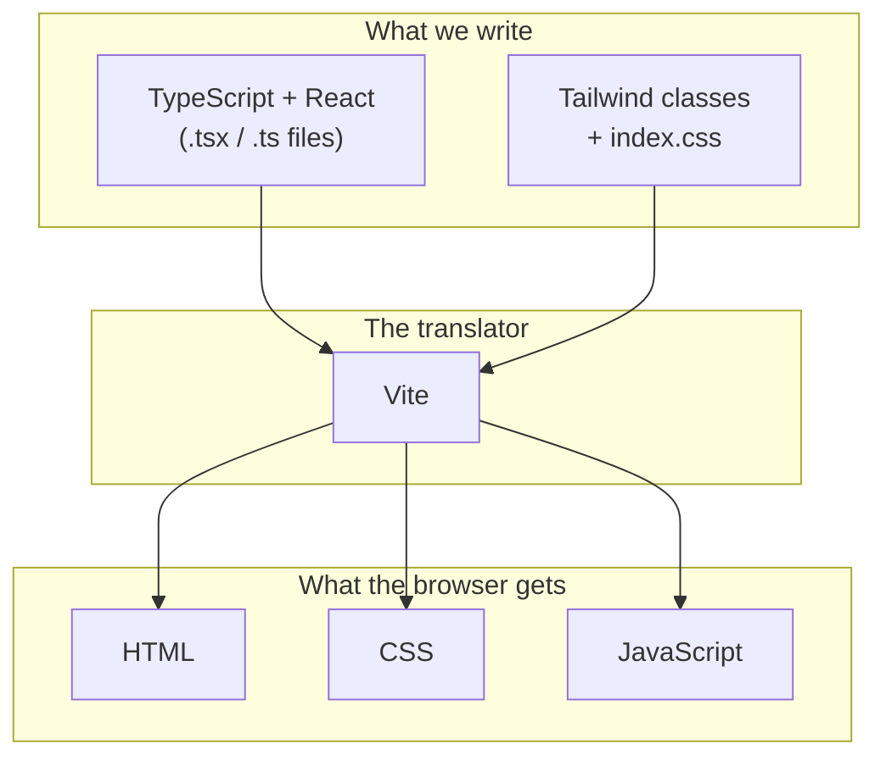

# 1. Web basics

Before looking at this project, here are the building blocks every website is made of, and the tools this one
uses on top of them.

## The three languages of the browser

A browser (Chrome, Safari…) only understands three things:

| Language | Job | Analogy |
|---|---|---|
| **HTML** | *What* is on the page: headings, paragraphs, images, buttons | The skeleton |
| **CSS** | *How it looks*: colours, sizes, positions, fonts, animations | The skin and clothes |
| **JavaScript (JS)** | *What it does*: reacting to clicks, scrolling, timers | The muscles and brain |

A tiny example of all three:

```html
<button class="big-button">Say hi</button>           <!-- HTML: a button exists -->
```
```css
.big-button { background: black; color: white; }    /* CSS: it's black with white text */
```
```js
document.querySelector('.big-button')
  .addEventListener('click', () => alert('Hi!'))     // JS: clicking it shows a message
```

Everything else in this project eventually turns into these three languages.

## The tools this project adds on top

Writing a big site in raw HTML/CSS/JS gets messy, so we use tools that make it easier. The browser never sees
them directly: they're translated into plain HTML/CSS/JS first.



### React: build the page out of reusable pieces ("components")

Instead of one giant HTML file, React lets you split the page into **components**. Each one is a function that
returns a chunk of page. Our site has components like `Nav`, `Hero`, `About` and `Contact`.

```tsx
// A component is just a function whose name starts with a capital letter
function Greeting() {
  return <h1>Hello, I'm Majed</h1>
}
```

That `<h1>…</h1>` inside JavaScript is called **JSX**: HTML-like syntax you can write inside JS. React turns it
into real HTML.

You use a component like an HTML tag: `<Greeting />`.

### Props: passing information into a component

Components can take inputs, called **props**, like a function takes arguments:

```tsx
function Greeting({ name }: { name: string }) {
  return <h1>Hello, I'm {name}</h1>     // {curly braces} = "insert this JS value here"
}

<Greeting name="Majed" />               // → <h1>Hello, I'm Majed</h1>
```

In this project, every section receives a prop called `n`: its section number, like `"03"`.

### State: things that change while you look at the page

**State** is a component's memory. When state changes, React redraws that component. For example, the About
section remembers which page you're on:

```tsx
const [page, setPage] = useState(0)     // page starts at 0 (Résumé)
setPage(1)                              // switch to Projects → React redraws
```

Functions that start with `use…` (`useState`, `useEffect`, `useRef`) are called **hooks**. They give a
component superpowers: memory (`useState`), "do something after drawing" (`useEffect`), or "hold on to a real
HTML element" (`useRef`).

### TypeScript: JavaScript with labels

TypeScript (`.ts` / `.tsx` files) is JavaScript plus **types**: labels saying what kind of value something is.
They catch mistakes before the site even runs.

```ts
let year: string = '2026'   // ✅
let year: string = 2026     // ❌ TypeScript complains: that's a number, not text
```

`.tsx` = TypeScript **with** JSX (components). `.ts` = plain TypeScript (data, helpers).

### Vite: the translator and live server

**Vite** does two jobs:
1. **While you work** (`pnpm dev`): runs a local server at `localhost:8443`, translates your files on the fly,
   and refreshes the browser the moment you save. This is called *hot reload*.
2. **When you're done** (`pnpm build`): bundles everything into a small, fast `dist/` folder you can upload to
   any web host.

### Tailwind: styling with short class names

**Tailwind CSS** gives you thousands of tiny ready-made CSS classes. Instead of writing CSS, you list classes on
the element:

```tsx
<p className="text-lg text-ash mt-4">Hello</p>
//            ↑ large  ↑ grey  ↑ margin-top
```

(`className` is React's name for HTML's `class`.) More in [chapter 4](04-styling-and-design.md).

### Packages, npm/pnpm and node_modules

Other people's code, like React, GSAP (animations) or three.js (3D), comes as **packages**. A **package
manager** downloads them:

- [`package.json`](../package.json) lists which packages the project needs.
- `pnpm install` downloads them into the **`node_modules/`** folder. It's huge and generated, so you never edit
  it or upload it.
- `pnpm-lock.yaml` pins the exact versions so every install is identical.

## Import and export: how files talk to each other

This is the part that most confuses beginners, so slowly:

**A file only sees what it imports.** Each file is sealed off. To use something from another file, that file
must **export** it, and your file must **import** it.

```ts
// src/data.ts: makes LINKS available to other files
export const LINKS = { github: 'https://github.com/MajedTuah' }
```

```tsx
// src/components/Contact.tsx: brings LINKS in
import { LINKS } from '../data'
//       ↑ the name     ↑ where it lives (path relative to THIS file)

<a href={LINKS.github}>GitHub</a>
```

### Reading an import path

| Path | Means |
|---|---|
| `'./ui'` | `ui.tsx` in the **same folder** as this file |
| `'../data'` | go **up one folder**, then `data.ts` |
| `'../motion/gsap'` | up one folder, into `motion/`, then `gsap.ts` |
| `'react'`, `'gsap'`, `'lenis'` | no dot means a **package** from `node_modules/` |

You can leave out the `.ts` / `.tsx` ending: the tools find it.

### Two kinds of export

```ts
export const LINKS = …                 // "named" export   → import { LINKS } from '../data'
export default function Hero() { … }   // "default" export → import Hero from './Hero'
```

A file can have many named exports but only one default. In this project, **each component file default-exports
its main component**, and helper files (`ui.tsx`, `hooks.ts`, `data.ts`) use named exports.

### Importing non-code files

Vite also lets you import images and CSS:

```tsx
import portrait from '../assets/portrait-cutout.webp'   // gives you a URL to use in 
import './index.css'                                    // just "load this CSS"
```

Next: [2. Project map →](02-project-map.md)
