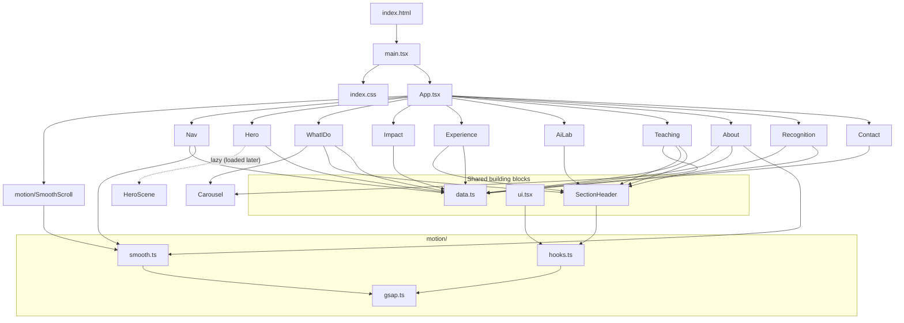

# 2. Project map

## The folders

```
majedtuah.com/
├── index.html            ← the single HTML page: title, description, favicon, robots tag; React fills in the rest
├── package.json          ← list of packages + the dev/build commands
├── pnpm-lock.yaml        ← exact package versions (generated, don't edit)
├── vite.config.ts        ← Vite settings: React + Tailwind plugins, port 8443
├── tsconfig.json         ← TypeScript settings
├── COPY_RULES.md         ← the writing rules for every word on the site
├── docs/                 ← you are here
├── public/               ← files served as-is (not processed)
│   ├── favicon.png       ←   the little browser-tab icon
│   ├── robots.txt        ←   tells search engines not to list the site (for now)
│   └── MajedTuah_Resume.pdf ← the "Download CV" file
├── node_modules/         ← downloaded packages (generated, never edit)
└── src/                  ← ALL the website's code
    ├── main.tsx          ← starting point: loads CSS and mounts <App />
    ├── App.tsx           ← puts the sections in order
    ├── index.css         ← colours, fonts, and every custom style/animation
    ├── data.ts           ← ALL the content (text, jobs, projects, links)
    ├── vite-env.d.ts     ← tells TypeScript that image imports are OK
    ├── assets/
    │   └── portrait-cutout.webp ← your photo with the background removed
    ├── components/       ← one file per section (plus shared pieces)
    └── motion/           ← animation helpers (GSAP, smooth scroll, hooks)
```

**`public/` vs `src/assets/`:** files in `public/` keep their exact name and URL (`/MajedTuah_Resume.pdf`).
Files in `src/assets/` are imported by code, and Vite renames them with a fingerprint
(`portrait-cutout-C6Tq….webp`) so browsers always fetch the newest version.

## Every file in `src/components/`

| File | What it is | Shown on the page as |
|---|---|---|
| `Nav.tsx` | Floating top bar, the KL clock, and the mobile menu | The bar at the top |
| `Hero.tsx` | Intro splash, your name, photo, project books, parallax | First screen |
| `HeroScene.tsx` | The 3D glass panel and spheres (three.js) | Behind your photo |
| `WhatIDo.tsx` | "What I build" capability cards | Section 01 |
| `Impact.tsx` | Count-up numbers (**hidden until `IMPACT` has data**) | Between 01 and 02 |
| `Experience.tsx` | Career timeline with stacking cards | Section 02 |
| `AiLab.tsx` | Interactive BrainDump router and RAG pipeline demos | Section 03 |
| `Teaching.tsx` | Teaching cards (FAMA, workshop, Timedoor) | Section 04 |
| `About.tsx` | Two pages: Résumé and Projects | Section 05 |
| `Recognition.tsx` | Awards and recommendations (**hidden until there's data**) | Before Contact |
| `Contact.tsx` | "Email me." section and the footer | Last section |
| `Carousel.tsx` | Reusable carousel (used by WhatIDo and Teaching) | Shared piece |
| `SectionHeader.tsx` | Reusable big heading with the outlined word and Arabic word | Shared piece |
| `ui.tsx` | Small shared helpers: icons, `Reveal`, `LineP`, `Section`, `Rich`… | Shared pieces |

## Every file in `src/motion/`

| File | What it does |
|---|---|
| `gsap.ts` | Loads GSAP and its plugins (ScrollTrigger, SplitText) **once**, sets the default easing |
| `smooth.ts` | Creates the Lenis smooth-scroll engine; `scrollToHash('#about')` glides to a section |
| `SmoothScroll.tsx` | Switches smooth scroll on and makes every `#link` on the page glide instead of jump |
| `hooks.ts` | `useClock` (KL time), `useMagnetic` (buttons that lean to the mouse), `useLineReveal` (lines rising) |

## Who imports whom

Arrows mean "imports". Read it top-down: `main.tsx` is the root, everything flows from there.



Two patterns are worth noticing:
- **`data.ts` sits at the centre.** Almost every section imports its words from there, which is why editing
  content never needs you to touch a component.
- **`HeroScene` has a dotted line.** It's *lazy-loaded*: the 3D code (about 1 MB) downloads separately, after
  the rest of the page has appeared, so it never slows down the first screen.

## The packages we use (from `package.json`)

| Package | What for |
|---|---|
| `react`, `react-dom` | The component system |
| `tailwindcss`, `@tailwindcss/vite` | Utility CSS classes |
| `gsap`, `@gsap/react` | Animation engine (timelines, scroll-triggered animation, text splitting) |
| `lenis` | Smooth, momentum-style scrolling |
| `three`, `@react-three/fiber`, `@react-three/drei` | The 3D scene in the hero |
| `vite`, `@vitejs/plugin-react`, `typescript`, `@types/three` | Build tools (development only) |

Next: [3. How the page comes together →](03-how-the-page-comes-together.md)
