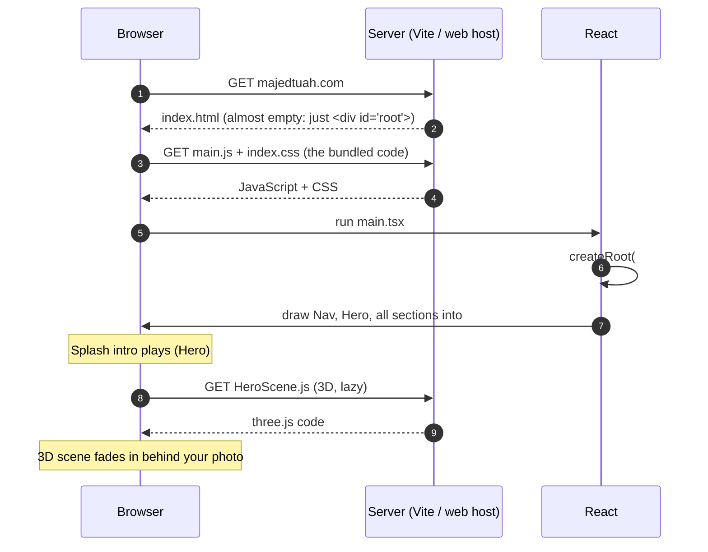
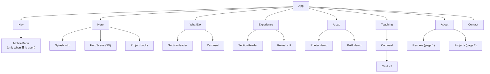
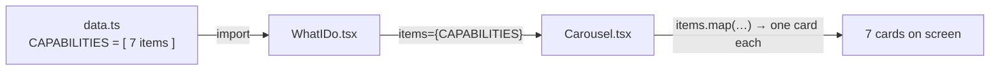
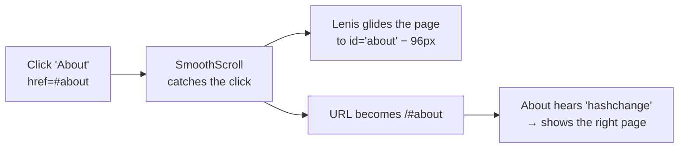

# 3. How the page comes together

## From typing the address to seeing the page



1. **[`index.html`](../index.html)** is nearly empty. Its key line is `<div id="root"></div>`: an empty box.
2. It loads **[`src/main.tsx`](../src/main.tsx)**, which does exactly three things:
   ```tsx
   import './index.css'                       // load all styles
   import App from './App'                    // get the whole page
   createRoot(document.getElementById('root')!).render(<App />)  // draw it into the empty box
   ```
3. **[`App.tsx`](../src/App.tsx)** lists the sections in order. This is the entire page structure:
   ```tsx
   <SmoothScroll />      {/* invisible: switches on smooth scrolling */}
   <Nav />
   <main>
     <Hero />
     <WhatIDo n={next()} />       {/* 01 */}
     <Impact />                   {/* hidden while empty */}
     <Experience n={next()} />    {/* 02 */}
     <AiLab n={next()} />         {/* 03 */}
     <Teaching n={next()} />      {/* 04 */}
     <About n={next()} />         {/* 05 */}
     {hasRecognition && <Recognition n={next()} />}
     <Contact n={next()} />
   </main>
   ```
   `next()` hands out `"01"`, `"02"`… in order, so section numbers stay correct automatically when a section is
   hidden. **To reorder the page, reorder these lines.**

## The component tree

Components contain other components, like boxes inside boxes:



## How content flows from `data.ts` to the screen

Components don't contain your words. They **read them from `data.ts`** and loop over them. For example,
`WhatIDo` draws one card per item in `CAPABILITIES`:



In code, "loop and draw one per item" is `.map()`:

```tsx
{CAPABILITIES.map((c) => (
  <article>
    <h3>{c.title}</h3>
    <p>{c.text}</p>
  </article>
))}
```

So **adding an item to the list in `data.ts` automatically adds a card**. No component changes needed.

### What lives in `data.ts`

| Export | Used by | Holds |
|---|---|---|
| `LINKS` | Nav, Hero, About, Contact | GitHub, LinkedIn, email, CV links |
| `PROJECTS` | Hero (books), About page 2 | Nexa + the 4 GitHub projects |
| `MORE_PROJECTS` | About page 2 ("Earlier work") | Smaller projects without links |
| `CAPABILITIES` | WhatIDo | The 7 "What I build" cards |
| `TEACHING` | Teaching | FAMA course, workshop, Timedoor |
| `RESUME` | Experience, About page 1 | Name, summary, jobs, skills, education, certification |
| `IMPACT` | Impact | Count-up numbers. **Empty, so the section is hidden** |
| `AWARDS`, `RECOMMENDATIONS` | Recognition | **Empty, so the section is hidden** |

## How a component decides to hide itself

`Impact.tsx` shows the pattern: if there's nothing to show, return nothing.

```tsx
if (IMPACT.length === 0) return null   // null = draw nothing at all
```

The moment you add a number to `IMPACT` in `data.ts`, the section appears.

## How the nav links work

Every link like `<a href="#about">` points at an element with `id="about"`. Normally the browser would *jump*
there. [`SmoothScroll.tsx`](../src/motion/SmoothScroll.tsx) catches every click on a `#…` link and *glides*
there instead, stopping 96px short so the fixed navbar doesn't cover the heading.



The navbar also highlights the section you're in: on every scroll it checks which section's top has passed 40%
of the screen.

## The About pager (two "pages" in one section)

`About.tsx` keeps one piece of state, `page` (`0` = Résumé, `1` = Projects), and shows one of two inner
components:

```tsx
{page === 0 ? <Resume /> : <Projects />}
```

Clicking a tab calls `turn(1)`, which updates `page`. In Chrome this is wrapped in the browser's
**View Transitions API**, which captures the old page and blurs and lifts it away while the new one slides in.
The links `/#about` and `/#projects` open the matching page directly.

Next: [4. Styling and design →](04-styling-and-design.md)
