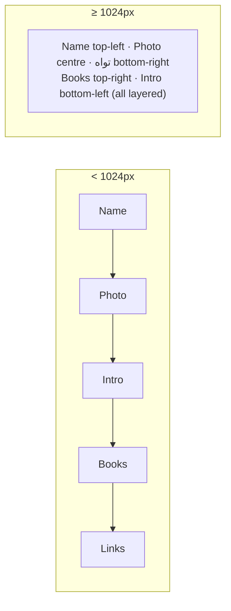

# 4. Styling and design

There are two places styles come from, and you'll see both in every component:

| Where | Looks like | Good for |
|---|---|---|
| **Tailwind classes** in the component | `className="text-lg text-ash mt-4"` | One-off layout: spacing, sizes, colours |
| **Custom CSS** in [`src/index.css`](../src/index.css) | `className="glass"` | Reused looks and anything animated |

## Reading Tailwind classes

Each class does one small thing. Once you know the patterns, they read like a sentence.

| Class | Means |
|---|---|
| `p-7`, `px-5`, `pt-32` | padding (all sides / left+right / top). Numbers × 4px, so `p-7` = 28px |
| `m-0`, `mt-4`, `mb-16` | margin (space outside) |
| `gap-6` | space between items in a row/column |
| `flex`, `flex-col`, `grid`, `grid-cols-2` | layout: in a row, in a column, in a grid |
| `items-center`, `justify-between` | alignment inside a flex row |
| `text-lg`, `text-[30px]` | font size (named, or exact in `[ ]`) |
| `text-bone`, `text-ash`, `bg-ink` | colours. These names are **ours**, defined in `index.css` |
| `text-bone/20`, `border-accent/40` | the same colour at 20% / 40% opacity |
| `rounded-3xl`, `rounded-full` | rounded corners / a pill shape |
| `hidden lg:flex` | hidden on small screens, shown from the `lg` width (1024px) up |
| `md:`, `lg:`, `xl:` prefixes | apply only from that screen width upward (768 / 1024 / 1280px) |
| `hover:text-bone` | apply only while the mouse is over it |

**Square brackets mean "exact value":** `w-[340px]`, `text-[clamp(64px,9.5vw,156px)]`. `clamp(min, ideal,
max)` means "scale with the window, but never smaller than min or bigger than max".

## `index.css`, section by section

| Part | What it holds |
|---|---|
| `@import url(…)` lines | Load the fonts: **Sentient** (English) from Fontshare; **IBM Plex Mono** and **Reem Kufi** (Arabic) from Google Fonts |
| `@theme { … }` | **The design tokens.** Every colour and font name the site uses |
| `@layer base { … }` | Defaults for `body`, links and text selection |
| `.glass`, `.ink-btn`, `.eyebrow`… | Reusable looks (see below) |
| Hero styles | Name size, layer positions, splash, the 3D book |
| Motion layer | Reveals, stacking cards, mobile menu, carousel, page transitions |
| `@media (prefers-reduced-motion: reduce)` | Turns animations off for visitors who ask their OS for less motion |

### The colour tokens

Defined once in `@theme`, used everywhere as `text-…`, `bg-…`, `border-…`:

| Token | Value | Used for |
|---|---|---|
| `ink` | `#0b0b0c` | Page background (obsidian) |
| `bone` | `#e7e6e2` | Main text (soft white) |
| `ash` | `#8e8d89` | Secondary text (grey) |
| `mist` | `#bebdb8` | Body paragraphs |
| `accent` | `#d4d3ce` | Highlights: outlined words, dates, active bars (silver) |
| `graphite`, `charcoal`, `steel` | dark greys | Surfaces and the timeline gradient |

**Change a token, and every place using it changes.** That's the point of tokens.

### The fonts

| Font | Class | Used for |
|---|---|---|
| Sentient (serif) | default, and `.disp` | All English text and headings |
| IBM Plex Mono | `.mono`, `.eyebrow` | Small uppercase labels, dates, numbers |
| Reem Kufi | `.ar` | Every Arabic word (مجيد, تواه, عمل…) |

### The reusable looks

| Class | Look |
|---|---|
| `.glass` | Dark smoked glass: faint gradient, thin light border, soft shadow. Used for cards and panels |
| `.glass-blur` | Navbar only: solid smoked glass so it stays readable over moving content |
| `.ink-btn` + `.btn-light` | Pill button; a fill sweeps up from the bottom on hover |
| `.ink-btn` + `.btn-glass` | The same button in glass |
| `.eyebrow` | Small mono uppercase grey label (`02 — CAREER`) |
| `.section-title` + `.outline-word` | The huge light section heading, with its outlined word |
| `.glow` | Soft radial pool of light behind sections |

## Responsive design (phones vs desktop)

The site is built **mobile-first**: classes without a prefix apply everywhere, and `md:` / `lg:` add desktop
changes. The hero is the big exception. On desktop its pieces are absolutely positioned like a poster. Below
1024px, a `@media (max-width: 1023px)` block in `index.css` stacks them in a column instead.

Other things that change by screen size:
- The navbar links collapse into the **☰ mobile menu**.
- Carousels switch from **scroll-driven** (desktop) to **swipe** (phone).
- Experience cards only **stack** on desktop.

## The copy rules

Every word follows [`COPY_RULES.md`](../COPY_RULES.md): headline is a person, first person, exact facts, one
filled button per screen, and a list of banned words ("leverage", "seamless"…).

Next: [5. Animation and motion →](05-animation-and-motion.md)
