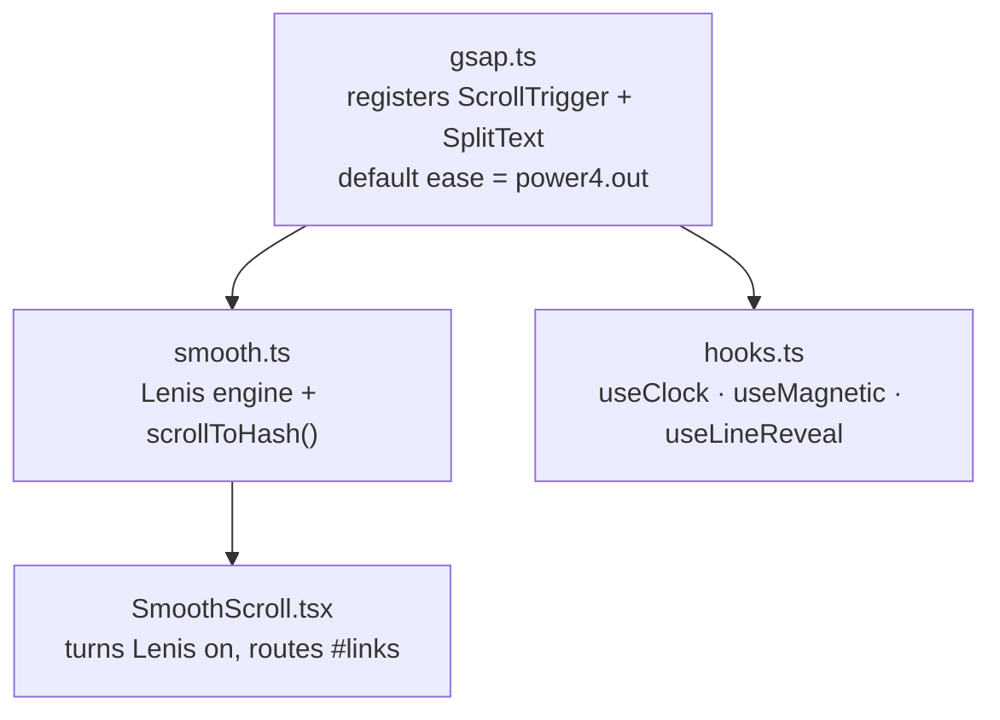
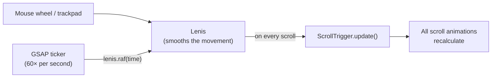
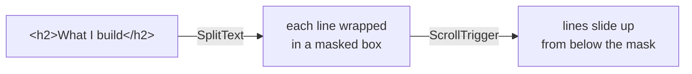
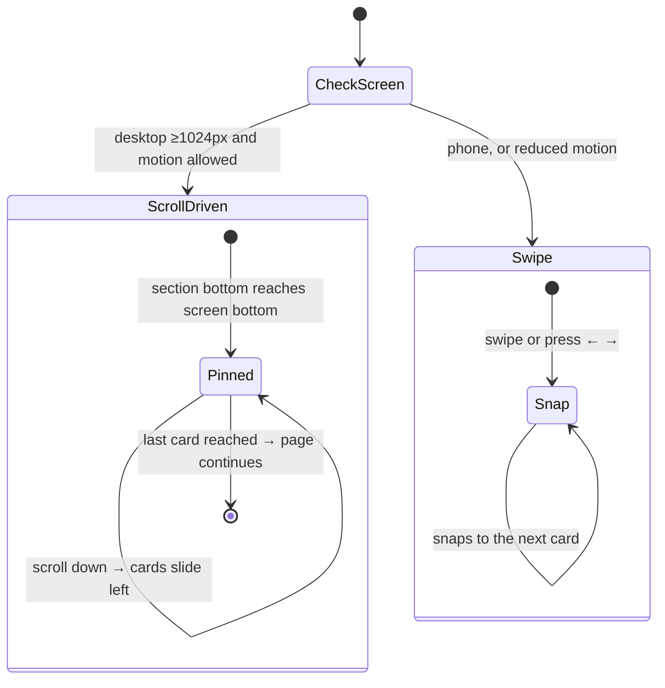
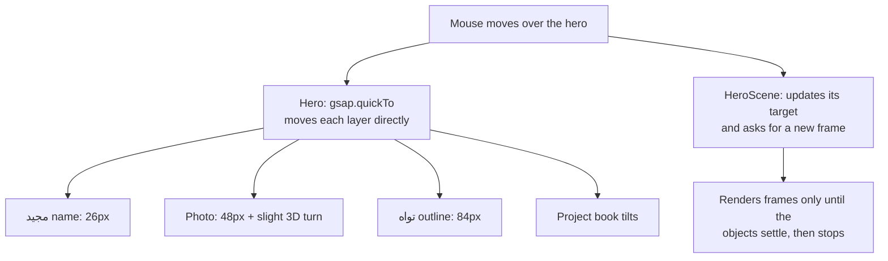

# 5. Animation and motion

## Two ways things move on this site

| Way | How it works | Used for |
|---|---|---|
| **CSS transitions / keyframes** | In `index.css`: "when this class changes, animate over 0.8s" | Hovers, button fills, the book page-turn, card reveals |
| **GSAP** (JavaScript) | Code that animates values frame by frame, often tied to scrolling | Intro timeline, text-line reveals, stacking cards, carousels, parallax |

Everything respects **reduced motion**: if a visitor has asked their computer for less motion, the intro is
skipped, scrolling is normal and content appears straight away.

## The motion toolkit (`src/motion/`)



**Always import GSAP from `../motion/gsap`, never straight from `'gsap'`.** That file registers the plugins
exactly once.

## 1. The intro splash (`Hero.tsx`)

One GSAP **timeline**: a list of animations placed at exact times. The whole timeline plays at **half speed**
(`timeScale(0.5)`), so every time below is doubled on screen.

```mermaid
gantt
    title Splash timeline (timeline seconds; real time is 2×)
    dateFormat  s
    axisFormat  %S s
    section Arabic name
    Outline traces (مجيد تواه)   :0.1, 0.75s
    Ink fills the letters        :0.7, 0.65s
    section Latin name
    M A J E D  T U A H rise      :0.25, 0.9s
    Tagline + counter fade in    :0.45, 0.6s
    section Counter
    000 → 100                    :0, 1.3s
    section Exit
    Hero entrance starts         :milestone, 1.4, 0s
    Page lifts away              :1.4, 0.85s
```

When the page has lifted, the hero's own entrance plays: the name rises, the photo slides up, and the books and
intro fade in. That part is CSS (the `.go` class on the hero). **Replay intro** sets the splash back on and the
timeline runs again.

## 2. Smooth scrolling (Lenis)

Normally a scroll wheel moves the page in steps. **Lenis** smooths that into gliding momentum. It must stay in
sync with GSAP's scroll animations, so both run on the same clock:



The `lerp: 0.16` setting in [`smooth.ts`](../src/motion/smooth.ts) controls how tightly the page follows the
wheel. Higher is snappier; lower is floatier.

## 3. ScrollTrigger: "animate when this reaches the screen"

ScrollTrigger is the GSAP plugin behind every scroll effect. You give it a **trigger** element and a **start**
line:

```ts
gsap.from(lines, {
  yPercent: 110,                                    // start 110% lower (hidden under a mask)
  stagger: 0.08,                                    // each line 0.08s after the previous
  scrollTrigger: { trigger: el, start: 'top 88%', once: true },
  //              "when the element's TOP reaches 88% down the screen, play once"
})
```

| Setting | Meaning |
|---|---|
| `start: 'top 88%'` | element's top meets the line 88% down the screen |
| `once: true` | play once, don't reverse when scrolling back up |
| `scrub: true` | tie progress directly to the scrollbar: scroll back and it rewinds |
| `pin: true` | hold the element still while you keep scrolling |

## 4. Text that rises line by line (`useLineReveal`)

Used by every section heading (`SectionHeader`), intro paragraphs (`LineP`) and the Contact heading.



**SplitText** cuts text into separate lines. Each line sits in an `overflow: hidden` box (the mask) and slides up
into view. **Arabic is never split**, because splitting breaks how Arabic letters join.

## 5. Card reveals (`Reveal` in `ui.tsx`)

Two variants, both driven by the browser's **IntersectionObserver** ("tell me when this is on screen"):

| Variant | Effect |
|---|---|
| `fade` | rises 28px and fades in |
| `wipe` | uncovered left to right by a `clip-path` (Liminal-style) |

Important detail: the observer watches an **outer** box and the clip happens on an **inner** box. Watching the
clipped box itself never fires in Chrome (see [chapter 7](07-performance-and-lessons.md)).

## 6. Carousels (`Carousel.tsx`)

The same component behaves differently by device:



- **Scroll-driven:** a ScrollTrigger **pins** the section and turns vertical scrolling into the track's
  horizontal position (`scrollLeft = progress × maxScroll`). The ← → buttons scroll the *page* to the point
  where that card is current, so scrolling and buttons always agree.
- **Swipe:** a normal horizontal scroller with **scroll-snap**.
- In both modes the current card is bright, upcoming cards are dimmed (38%) and passed cards are faded (12%),
  and the track's left edge fades out. The track bleeds to both screen edges.

## 7. Experience stacking cards (`Experience.tsx`)

On desktop each card is `position: sticky`, so it sticks 120px from the top, each 18px lower than the last. A
scrubbed ScrollTrigger shrinks each earlier card to 94% and dims it as the next one slides over it. The
timeline line on the left fills with your scroll progress, and each dot lights up as the line passes it.

## 8. Hero parallax and the 3D scene



- Layers further back move less, which creates the depth.
- **`quickTo`** is GSAP's fastest way to chase a moving target: it changes only `transform`, which the graphics
  card handles without recalculating the page.
- **The 3D scene** (`HeroScene.tsx`) uses **three.js** through **React Three Fiber**, which lets you write 3D
  objects as components:
  ```tsx
  <mesh position={[2, 1, 0]}>
    <sphereGeometry args={[0.5, 48, 48]} />        {/* shape: a sphere */}
    <meshPhysicalMaterial color="#060607" roughness={0.12} clearcoat={1} />  {/* surface */}
  </mesh>
  ```
  It's lit by soft "light formers" (virtual softboxes), and it uses `frameloop="demand"`, so it draws only
  while something is moving.

## 9. The project books (Hero)

Every 3.4 seconds the next book arrives. The book is real 3D (`preserve-3d`):
1. The outgoing cover **turns like a page** on its left spine (`rotateY(-105deg)`).
2. The new cover eases in flat, a beat later.
3. The label and the inner page crossfade.

Each layer sits at its own depth (page `-6px`, covers `+2–3px`). That's what stops surfaces from cutting
through each other. Hovering opens the cover to show the summary.

## 10. Small touches

| Effect | Where |
|---|---|
| Magnetic buttons (lean toward the mouse) | `useMagnetic` in `hooks.ts`, on "See my work", "Contact" and the email button |
| Live Kuala Lumpur clock | `useClock` in `hooks.ts`, in the navbar, footer and mobile menu |
| About page slide | View Transitions API in `About.tsx` + `::view-transition-*` CSS |
| Mobile menu links rising | GSAP in `MobileMenu` (`Nav.tsx`) |
| AI Lab tiers lighting up | timers + CSS classes in `AiLab.tsx` |

Next: [6. How to change things →](06-how-to-change-things.md)
