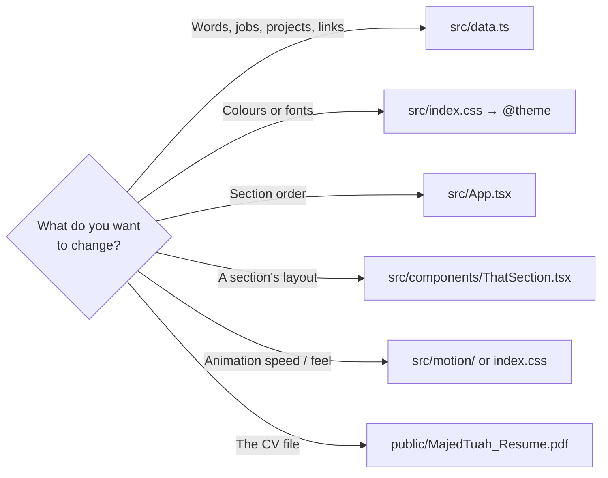

# 6. How to change things

Start the dev server first (`npx.cmd pnpm@11 dev`) and keep http://localhost:8443 open. Every save updates
the page instantly. If something breaks, the browser shows a red error overlay saying which file and line.



## Content (all in [`src/data.ts`](../src/data.ts))

### Edit any text
Find it in `data.ts` and change the words between the quotes. Keep the quotes and the comma at the end:
```ts
title: 'Request routing',      // ← change only what's between the ' '
```
**An apostrophe inside text** must be the curly one (`’`), or the line will break: `'I’ve taught…'`.
**Bold** words in experience bullets use double asterisks: `'Built a **financial RAG pipeline** on…'`.

### Add a "What I build" card
Copy one block inside `CAPABILITIES`, paste it after the last one, and edit it:
```ts
{
  ar: 'بيانات',                    // one Arabic word, shown big and outlined
  title: 'Your new card title',
  text: 'One plain sentence about it.',
  tags: ['Tool one', 'Tool two'],
},
```
The carousel picks it up automatically, and the counter becomes "01 / 08".

### Add a job
Copy a block inside `RESUME.experience` (newest first):
```ts
{
  role: 'Your title',
  company: 'Company',
  place: 'City, Country',
  period: 'Jan 2027 — Present',
  points: ['What you did, with **the key thing** in bold', 'Another point'],
},
```

### Add a project
- **With a link** (shows as a hero book *and* a Projects row): copy a block in `PROJECTS`. Its `colors` set the
  book cover colours. Add `orb: '#3b82f6'` for a glowing ball like Nexa's.
- **Without a link** ("Earlier work"): copy a block in `MORE_PROJECTS`.

### Let Google list the site
Right now the site asks search engines not to list it. When you're ready, delete the `<meta name="robots" …>`
line in `index.html` and the file `public/robots.txt`.

### Turn on the hidden sections
Add items to `IMPACT`, `AWARDS` or `RECOMMENDATIONS`, and that section appears with the right number:
```ts
export const IMPACT = [
  { value: 70, suffix: '%', label: 'Less manual document processing' },
]
```

### Change your email, LinkedIn or the CV
Your email is `EMAIL` at the very top of `data.ts`: change it once and the link and every place it's shown update.
GitHub, LinkedIn and the CV are in `LINKS` right below it. To replace the CV, swap the file in `public/`, keeping the name
`MajedTuah_Resume.pdf`, or update `LINKS.cv` to the new name.

## Design

### Change a colour everywhere
In [`src/index.css`](../src/index.css), inside `@theme { … }`:
```css
--color-accent: #d4d3ce;   /* silver highlights → change this hex */
```
Keep text colours light enough to read on the black background. Aim for a contrast of 4.5:1 (any "contrast
checker" website will tell you).

### Change the headline
The hero headline is in [`Hero.tsx`](../src/components/Hero.tsx). Search for `I have Claude Code`.

### Change a section heading
Each section passes its heading to `SectionHeader`, for example in `WhatIDo.tsx`:
```tsx
<SectionHeader n={n} label="What I do" title="What I" outlined="build" ar="عمل" />
//                                       solid part   outlined part   Arabic word
```

### Reorder or remove sections
In [`App.tsx`](../src/App.tsx), move or delete lines like `<Teaching n={next()} />`. The numbering adjusts by
itself. If you remove a section, also remove its link from `LEFT` / `RIGHT` in `Nav.tsx`.

## Motion

| To change… | Where | Setting |
|---|---|---|
| Intro speed | `Hero.tsx` | `.timeScale(0.5)`: 1 = original, 0.5 = half speed |
| How "floaty" scrolling feels | `motion/smooth.ts` | `lerp: 0.16` (higher = snappier) |
| Book change interval | `Hero.tsx` | `BOOK_CYCLE = 3400` (milliseconds) |
| Passed / upcoming card opacity | `index.css` | `.car-slide.is-past { opacity: 0.12 }` / `.car-slide { opacity: 0.38 }` |
| Turn the 3D scene off | `Hero.tsx` | delete the `<div className="l-scene">…</div>` block |

## Before you publish

1. `npx.cmd pnpm@11 build`: it must end with `✓ built`. If it shows errors, fix those first.
2. `npx.cmd pnpm@11 preview`: click through the real, optimised site.
3. Upload the **`dist/`** folder to your host.

Next: [7. Performance and lessons learned →](07-performance-and-lessons.md)
