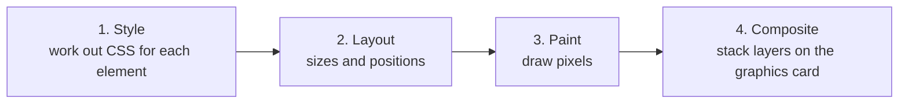

# 7. Performance and lessons learned

Fancy effects cost speed. This chapter records what we tried, what was too expensive, and the bugs we hit, so
nobody re-adds them by accident.

## How the browser draws a frame

To understand "lag", know the steps the browser runs up to 60 times a second:

- Changing **`transform`** or **`opacity`** only touches step 4. That's cheap, which is why almost all our
  animations use them.
- Changing sizes, positions or CSS variables can re-run steps 1–3 for many elements. That's expensive.
- Some effects make step 4 itself expensive, by forcing the graphics card to redo big areas every frame.

## Things we removed or changed, and why

| Effect | Problem | What we did |
|---|---|---|
| **Moving film grain** (full-screen, `mix-blend-mode`) | A blended full-screen layer forces the whole page to be recomposited every frame | Removed |
| **Backdrop blur on every glass card** | Each blurred panel re-blurs what's behind it on every scroll frame, and it's invisible on black anyway | Removed from cards; the navbar is now solid smoked glass |
| **Navbar blur over the 3D canvas** | Blurring over a live WebGL canvas forces the canvas to be read back and blurred every frame | Navbar made solid |
| **Parallax via CSS variables** | Setting `--mx` on the hero re-styled every element inside it on each mouse move | GSAP `quickTo` moves each layer's `transform` directly |
| **3D scene rendering non-stop** (60 fps) | Constant GPU work even when nothing moved | `frameloop="demand"`: draws only while easing; resolution capped at 1.25×; fewer polygons; one fewer glass pass |
| **Floating 3D objects** | Needed continuous frames | Removed so the scene can rest |

## Bugs we hit, and their causes

### Cards never appeared (What I build, Teaching)
The wipe reveal hid cards with `clip-path: inset(0 100% 0 0)` (zero width) and watched **that same element**
to decide when to reveal it. Chrome treats a fully clipped element as invisible, so the "it's on screen" signal
never fired.
**Fix:** watch an unclipped outer box and clip an inner one (`Reveal` in `ui.tsx`).

### Book cover cut in half
The book is real 3D. A tilted incoming cover passed *through* the flat inner page at the same depth.
**Fix:** give every layer its own depth (page `translateZ(-6px)`, covers `+2–3px`), and never tilt the incoming
cover. The page's fade animation also had to use `translate` rather than `transform`, so it wouldn't erase that
depth.

### Sticky stacking cards didn't stick
`position: sticky` silently stops working inside any parent with `overflow: hidden`.
**Fix:** sections use `overflow: clip`, which also hides overflow but doesn't break sticky.

### Carousel looked cut off on the left
The track only bled to the right edge of the screen.
**Fix:** bleed to both edges with matching padding, fade passed cards to 12%, and fade the track's left edge.
`scroll-padding` is set from code because CSS percentages measure the wrong box there.

## Environment gotchas

| Symptom | Cause | Fix |
|---|---|---|
| `npx : … running scripts is disabled` | Windows PowerShell blocks `.ps1` scripts | Type `npx.cmd`, or run once: `Set-ExecutionPolicy -Scope CurrentUser RemoteSigned` |
| pnpm complains about a "store location" | `node_modules` was installed by pnpm 11 | Always use `npx.cmd pnpm@11 …` |
| Site feels slow in `pnpm dev` | Dev mode is unoptimised and runs extra React checks | Judge speed with `build` + `preview` |
| Build warns "chunks larger than 500 kB" | That's the 3D library (three.js) | Expected. It loads separately, after the page |
| TypeScript error "declared but never used" | `tsconfig.json` forbids unused code, which keeps the project clean | Delete the unused import or variable |

## Bundle sizes (after `build`)

| File | Size (compressed) | When it loads |
|---|---|---|
| Main JS (React, GSAP, Lenis, the site) | ~132 KB | Immediately |
| CSS | ~10 KB | Immediately |
| HeroScene (three.js) | ~266 KB | After the page appears |
| Portrait | ~104 KB | With the hero |

Next: [8. Glossary →](08-glossary.md)
