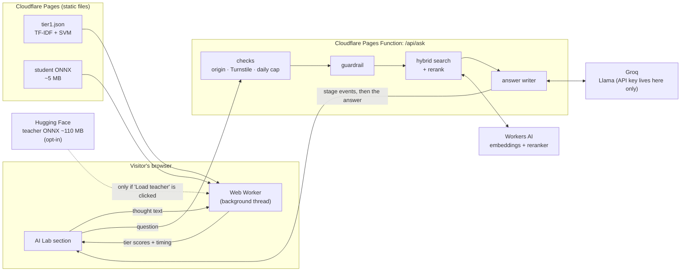

# 9. The AI Lab: what runs where

The AI Lab section has two demos. Both use **real AI**: nothing is faked or scripted. This chapter is the big picture. The next chapters go deeper:

- [10. BrainDump in the browser](10-braindump-in-the-browser.md): how your trained models run on the visitor's device
- [11. The RAG API](11-rag-api.md): how "Ask about my work" finds an answer and writes it
- [12. Security](12-security.md): why no key or endpoint can be abused
- [13. Deploy and domain](13-deploy-and-domain.md): putting it online, with the domain last
- [Decision log](decisions.md): *why* each piece was chosen

## The picture

## Demo 1: the BrainDump router (runs entirely in the browser)

- **What the visitor sees:** they type a thought ("pay the electricity bill tomorrow"), and three model cards light up in turn. Each card shows the model's real confidence and how many milliseconds it took on their own device. The arbitrator then picks a category: PERSONAL, FINANCIAL, PROJECTS, ADMIN or AUTOMATION.
- **What's really happening:** the models are the ones you trained in `braindump.ai-main`, converted to formats a browser can run.

  | Tier | Your model | In the browser | Size |
  |---|---|---|---|
  | 1 | TF-IDF + LinearSVC (`tier1_svm.pkl`) | Plain TypeScript maths over an exported JSON file | tens of KB |
  | 2 | Distilled, pruned, quantized bert-tiny (`student_quantized.pt`) | ONNX, run by transformers.js | ~5 MB |
  | 3 | BERT teacher (`teacher_bert/`) | ONNX, run by transformers.js, **opt-in** | ~110 MB |

- **The rules are the real ones,** copied from `ml/ensemble/arbitrator.py`:
  - If Tier 1 is at least **90%** sure, Tier 1 wins.
  - Otherwise, if Tier 2 is at least **85%** sure, Tier 2 wins. If Tier 1 picked the same category, the confidence is the average of the two.
  - Otherwise Tier 3 decides. If the teacher isn't loaded, Tier 2's answer is used.
- **Why in the browser?** It's free, private and has no server to attack ([D-003](decisions.md#d-003-the-braindump-router-runs-in-the-visitors-browser)).

## Demo 2: "Ask about my work" (a small server, a real LLM)

- **What the visitor sees:** they ask a question ("What RAG systems has Majed built?") and the six pipeline stages light up as they actually run. Then the answer streams in with numbered citations they can click.
- **What's really happening:**

  | Stage | When it runs | What it does |
  |---|---|---|
  | Ingest | Once, on your PC (`pnpm corpus`) | Collects text from `src/data.ts` and the project READMEs |
  | Chunk | Once, on your PC | Cuts it into small passages, each tagged with its source |
  | Embed | Once, on your PC | Turns each passage into a vector (a list of numbers that captures meaning) |
  | Retrieve | Every question | Keyword search + vector search, merged |
  | Rerank | Every question | A reranker model re-scores the top results; the best 3 go on |
  | Ground & answer | Every question | Llama on Groq answers **only** from those 3 passages and cites them |

  A guardrail runs before any of this and blocks prompt-injection attempts ("ignore your instructions…"). One of the example buttons deliberately tries one, so visitors can watch it being blocked.
- **Why a server here?** Writing an answer needs a large language model. That needs an API key, and a key must never be in the browser ([D-011](decisions.md#d-011-secrets-live-only-on-the-server)).

## Where each piece lives in the project

| Path | What |
|---|---|
| `tools/export/` | Python scripts that convert your BrainDump models for the browser and check they still give the same answers |
| `public/models/braindump/` | The converted Tier 1 and Tier 2 files, served as-is |
| `src/lab/router/` | The in-browser router: Tier 1 maths, the arbitrator, the Web Worker |
| `src/components/lab/` | The two demo screens (`RouterDemo.tsx`, `RagDemo.tsx`) |
| `functions/` | The `/api/ask` server code that runs on Cloudflare |
| `scripts/` | `build-corpus` (makes the RAG knowledge file) and `check-secrets` (fails the build if a key leaks) |

These folders are filled in as each phase lands. [CHANGELOG.md](../CHANGELOG.md) records when each one arrived.
