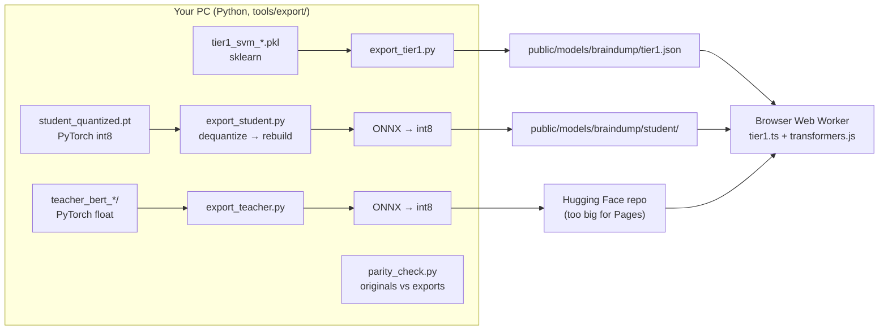

# 10. BrainDump in the browser

This chapter explains how your BrainDump models, trained in Python, end up running inside a visitor's browser tab. It also explains every tool used along the way. The reasons behind each choice are in the [decision log](decisions.md).

## The journey in one picture



## Words you need first

| Word | Plain meaning |
|---|---|
| **ONNX** | A file format for trained neural networks that any language can run, not just Python. "Open Neural Network Exchange". |
| **ONNX Runtime** | The engine that runs `.onnx` files. **onnxruntime-web** is its browser version, compiled to WebAssembly. |
| **WebAssembly (WASM)** | A way to run fast, compiled code (C++, Rust) inside a browser. ONNX Runtime is C++, so in the browser it runs as WASM. |
| **transformers.js** | Hugging Face's JavaScript copy of the Python `transformers` library. It loads a tokenizer and an ONNX model and runs them through onnxruntime-web. |
| **Tokenizer** | Turns text into the numbers a BERT model reads: "pay the bill" → `[101, 3477, 1996, 3021, 102]`. The browser must use *exactly* the same tokenizer as training. |
| **Quantization (int8)** | Storing each weight as a small whole number (−128 to 127) plus a scale, instead of a 32-bit decimal. The file is about 4× smaller and a bit faster, and a little less precise. |
| **Dequantize** | The reverse: whole number × scale → decimal again. |
| **Distillation** | Training a small "student" model to copy a big "teacher" model's answers. |
| **Pruning** | Setting the smallest 30% of the weights to zero. |
| **Web Worker** | A background thread in the browser. Heavy maths there doesn't freeze the page. |
| **Parity check** | Running the same sentences through the original and the converted model, and checking they agree. |

## Step 1: fix and retrain BrainDump (done once)

Before export, BrainDump had problems that meant every thought ended at Tier 3 ([D-017](decisions.md#d-017-fix-and-retrain-braindump-before-putting-it-on-the-site)). In short:

- Tier 1 used the wrong label names, because sklearn sorts them alphabetically.
- Tier 1 could never reach 90% confidence.
- The student was undertrained.

All of this is fixed in `braindump.ai-main`, and the models were retrained.

## Step 2: Tier 1 becomes plain numbers (`export_tier1.py`)

Tier 1 is TF-IDF + a linear SVM. It looks like ML, but at prediction time it's only arithmetic, so we don't ship any ML library ([D-004](decisions.md#d-004-tier-1-tf-idf--svm-is-rewritten-in-plain-typescript)). The script saves these numbers to `tier1.json`:

- `terms`: every word and two-word phrase ("bigram") the model knows
- `idf`: how rare each term is. Rare words count more.
- `coef` and `intercept`: the SVM's weights, one row per label
- `calibration`: one pair `(a, b)` per label that turns an SVM score into a probability

**Worked example:** here's what [`src/lab/router/tier1.ts`](../src/lab/router/tier1.ts) does with "Pay the electricity bill".

1. **Clean and split:** lowercase it and remove accents, then keep words of 2+ characters: `pay, the, electricity, bill`. Add the bigrams: `pay the, the electricity, electricity bill`.
2. **Weigh:** for each known term, `weight = (1 + log(count)) × idf`, so rare words like "electricity" count more than "the".
3. **Normalise:** scale the list of weights so it has length 1. Long and short sentences then compare fairly.
4. **Score:** for each label, `score = sum(weight × coef) + intercept`. That's the SVM's "margin".
5. **Probability:** `p = 1 / (1 + e^(a·score + b))` for each label, then divide by the total so they add up to 1. This is "Platt scaling", the calibration step.

The parity check proves these TypeScript numbers match sklearn's to 6+ decimal places, for every test sentence.

## Step 3: the student (`export_student.py`)

PyTorch's quantized layers can't be exported to ONNX ([D-006](decisions.md#d-006-rebuild-the-student-from-its-quantized-file-then-export-to-onnx)). So the script:

1. Loads `student_quantized.pt`, your distilled, pruned int8 bert-tiny.
2. Creates an empty bert-tiny of the same shape and copies every weight in. The int8 ones are **dequantized** back to decimals.
3. Checks that the rebuilt model gives the same probabilities as the original.
4. Exports it to ONNX with **Optimum**, Hugging Face's export tool.
5. Quantizes it again to int8 with ONNX Runtime. The result is about 4.5 MB.
6. Writes the folder layout transformers.js expects: `config.json`, `tokenizer.json`, `onnx/model_quantized.onnx`.

## Step 4: the teacher (`export_teacher.py`)

Same idea, but the teacher was never quantized, so it goes straight to ONNX, then int8. At about 110 MB it's too big for Cloudflare Pages, which has a 25 MB limit, so it goes to `tools/export/out/teacher/` (gitignored) and gets uploaded to Hugging Face ([D-005](decisions.md#d-005-the-teacher-model-is-opt-in-and-hosted-on-hugging-face)). Visitors download it only if they click **Load teacher**.

## Step 5: prove it (`parity_check.py`)

This runs 129 training sentences and 30 brand-new ones through both the originals and the exports. It fails if:

- Tier 1's JSON maths differs from sklearn by more than 0.0001
- Tier 2 or Tier 3 picks a different label on a *clear* case ([D-018](decisions.md#d-018-parity-checks-compare-clear-cases-only)), or its probabilities drift too far

It also writes:

- `src/lab/router/__fixtures__/golden.json`, the expected answers the TypeScript tests (`pnpm test`) compare against
- `public/models/braindump/manifest.json`, with each file's size and fingerprint (sha256), the labels, the thresholds, and three example sentences. Each example is chosen because it stops at a different tier.

## Step 6: in the browser

| File | Job |
|---|---|
| [`router.worker.ts`](../src/lab/router/router.worker.ts) | The Web Worker. It loads `tier1.json` straight away, the student when the AI Lab scrolls into view, and the teacher only on request. It runs one "warm-up" prediction per model, so the timings shown are real and not first-run slowness. |
| [`tier1.ts`](../src/lab/router/tier1.ts) | The Tier 1 maths above |
| [`arbitrator.ts`](../src/lab/router/arbitrator.ts) | The exact rules from `arbitrator.py`. It runs Tier 1, and Tier 2 only if needed, then Tier 3 only if needed. It times each tier with `performance.now()`. |
| [`useRouter.ts`](../src/lab/router/useRouter.ts) | The React hook that talks to the worker |
| [`RouterDemo.tsx`](../src/components/lab/RouterDemo.tsx) | The screen |
| [`scripts/copy-ort.mjs`](../scripts/copy-ort.mjs) | Copies ONNX Runtime's 14 MB WASM engine into `public/ort/` so we serve it ourselves ([D-015](decisions.md#d-015-serve-the-onnx-runtime-engine-from-our-own-site)) |

- **Runtime:** WebAssembly, one thread ([D-016](decisions.md#d-016-run-the-neural-tiers-on-webassembly-only-single-threaded)).
- **Caching:** the browser's Cache Storage keeps the models, so a return visit doesn't download them again.
- **Privacy:** nothing the visitor types is ever sent anywhere.

The cards light up about half a second apart so a person can follow along. The **millisecond numbers are the models' real times**; the delay is only for display.

## The teacher (Tier 3): where it loads from

| Where you are | Where the teacher comes from | What you need |
|---|---|---|
| **`pnpm dev`** on your PC | Your local `tools/export/out/teacher/`, served at `/models/braindump-teacher/` by a dev-only plugin in `vite.config.ts` | Nothing. Run `export_teacher.py` once. |
| **Production** (Cloudflare) | Your Hugging Face model repo | Upload it once (below) and set `VITE_TEACHER_REPO` |

Without `VITE_TEACHER_REPO`, production simply hides the button and the router falls back to Tier 2. That's the same thing BrainDump does when the teacher isn't there. The dev-only path is never included in the production build.

### Upload the teacher to Hugging Face (one time, and again after each retrain)

1. Create a free account at huggingface.co.
2. Create a **Model** repo named `braindump-teacher-onnx` and make it **Public**. It has to be public so visitors' browsers can download it, and it contains no secrets.
3. Create an access token: Settings → Access Tokens → **Write**. Treat it like a password. Never put it in this project or in a `VITE_` variable.
4. In the VS Code terminal:
   ```powershell
   tools\export\.venv\Scripts\python -m pip install huggingface_hub
   tools\export\.venv\Scripts\hf auth login          # paste the token when it asks; it's stored outside the project
   tools\export\.venv\Scripts\hf upload MajedTuah/braindump-teacher-onnx tools\export\out\teacher . --repo-type model
   ```
5. Tell the site where the teacher lives. Locally, in a `.env.local` file (gitignored):
   ```
   VITE_TEACHER_REPO=MajedTuah/braindump-teacher-onnx
   ```
   On Cloudflare Pages: Settings → Environment variables → add the same name and value. This is **public configuration, not a secret**: it ends up in the JavaScript, and that's fine, because it's only a repo name.

## How to redo this after you retrain BrainDump

Run these from the project folder in VS Code's terminal:

```powershell
tools\export\.venv\Scripts\python tools\export\export_tier1.py
tools\export\.venv\Scripts\python tools\export\export_student.py
tools\export\.venv\Scripts\python tools\export\export_teacher.py
tools\export\.venv\Scripts\python tools\export\parity_check.py
npx.cmd pnpm@11 test
```

Then upload `tools/export/out/teacher/` to Hugging Face again ([13-deploy-and-domain.md](13-deploy-and-domain.md)). If `.venv` is missing, create it once:

```powershell
py -3.11 -m venv tools\export\.venv
tools\export\.venv\Scripts\python -m pip install -r tools\export\requirements.txt
```

The scripts find your BrainDump folder at `C:\Users\majed\OneDrive\Documents\ML Projects\braindump.ai-main`. If it moves, set `BRAINDUMP_DIR` to the new path. They always use the newest timestamped `tier1_svm_*.pkl` and `teacher_bert_*/`, the same rule the BrainDump app uses.
