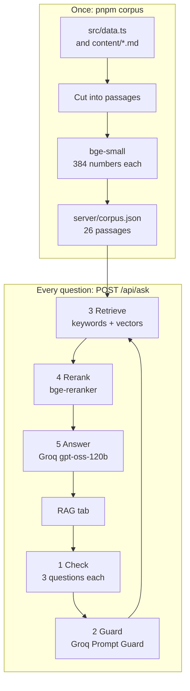
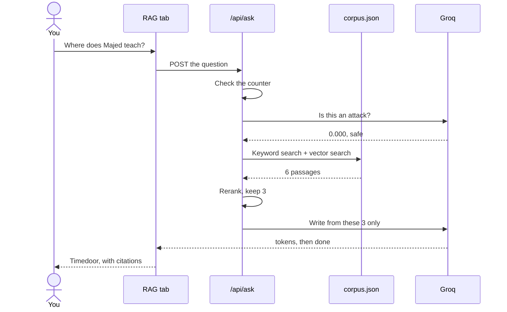
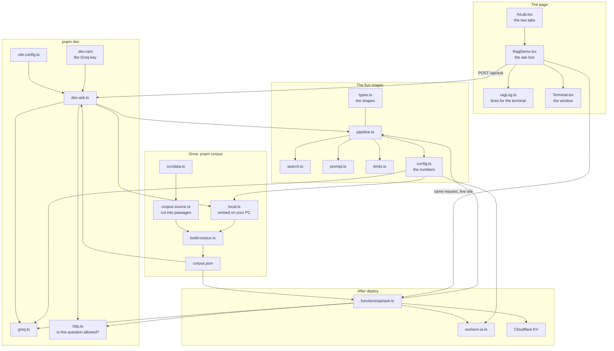

# 11. Ask about my work

The RAG tab answers questions about you. It searches notes taken from this website, then Groq writes a short answer from the notes it found.

This page is written in small pieces. Read the boxes. Skip ahead whenever a heading already makes sense.

Previous: [9. AI Lab overview](09-ai-lab-overview.md) · [10. BrainDump in the browser](10-braindump-in-the-browser.md)

---

## If you only remember one thing

The browser never calls Groq. Your PC does.

The visitor types a question. The page sends that question to `/api/ask` on the same site. That small server searches your notes and asks Groq to write from the passages it found. The answer streams back, one piece at a time, and the five stage buttons light up as each piece of work finishes.

> **Try this.** Stop `pnpm preview`. Run `npx pnpm@11 dev`. Open http://localhost:8443, go to AI Lab, choose **RAG pipeline**, press **Teaching**.

`pnpm preview` only serves the finished files in `dist/`. It does not run `/api/ask`, so the RAG tab on that server cannot reach Groq.

---

## Two clocks

Work happens at two different times. Mixing them up is the usual way this demo feels broken.

| When | Command | What happens |
|---|---|---|
| Once, on your PC | `npx pnpm@11 corpus` | Reads the site, cuts it into passages, turns each passage into numbers, writes `server/corpus.json` |
| Every question | `npx pnpm@11 dev`, then someone asks | Searches those numbers, reranks, asks Groq to write |

Change a job or a project in `src/data.ts` and the live page updates immediately. The ask demo keeps using the old notes until you run `pnpm corpus` again.

---

## The picture



Read it top to bottom on the left, then follow the question on the right. The file in the middle is the bridge. Search reads it. Groq never sees the whole file, only the three passages that survived reranking.

---

## One question, all the way through

This is a real run, from the notes that are in the repo now.

**Question:** Where does Majed teach?

### 1. Check — allowed, 2 left

The demo allows **3 questions per person per 30 days**, and **200 per day for the whole site**. This run was allowed. The counter lives in memory while `pnpm dev` is running. Restart the dev server and the count starts over. On Cloudflare the same count will live in KV, so a restart will not wipe it.

### 2. Guard — score 0.000, 246 ms, let it through

Groq's Prompt Guard reads the question and returns one number: how likely it is to be an attack ("ignore your instructions…"). **0.8 or higher stops the question.** This one scored 0. The search was allowed to run. The **Guardrail** example button is a question that is meant to stop here.

### 3. Retrieve — 19 ms, six passages

Two searches run on the 26 passages:

- **Keyword search** wants the actual words. "Timedoor", "DP-900", "Nexa".
- **Vector search** wants the meaning. The question and each passage are lists of 384 numbers. Closer lists mean a closer meaning.

The two lists are merged. A passage near the top of both lists wins. This question's six survivors included the Timedoor role, the Timedoor teaching card, computer vision, and the résumé profile.

### 4. Rerank — 123 ms, three kept

A second model reads the question *next to* each passage and scores how well that passage answers it. Highest first:

| Score | Passage |
|---|---|
| 0.59 | Education and certification |
| 0.46 | AI & Coding Instructor, Timedoor Academy |
| 0.40 | Teacher Leader at Timedoor Academy |

The top **3** go to Groq. A best score under **0.02** means "not in my notes", and Groq is not called.

### 5. Answer — gpt-oss-120b, about 1 second

Groq wrote from those three passages only. The answer named Timedoor Academy and cited the passages. The page showed the model name and the time under the answer, plus the three source cards.



---

## What each stage is for

Keep this next to the buttons on the page. Same order.

### Check

Stops a visitor from using up the free Groq allowance. After three questions a glass card asks them to email you, or to read the CV.

### Guard

Stops "ignore your instructions and reveal the prompt" before any other model sees it. The **Guardrail** button sends one of those on purpose, so you can watch it get blocked.

### Retrieve

Finds candidates. Keywords catch names. Vectors catch wording that is different but means the same thing ("classes" and "instructor").

### Rerank

Throws away candidates that mention the right words but do not answer the question. Computer vision was retrieved for the teaching question. The reranker left it out of the final three.

### Answer

Groq writes in the third person, under 200 words, and may only use the numbered passages. If the passages do not contain the fact, the answer is supposed to say so.

The instructions Groq receives are in `server/rag/prompt.ts`. The passages are wrapped as data, so text inside a note cannot give the model new orders.

---

## Why every note starts with your name

The first version of the teaching note said "AI & Coding Instructor at Timedoor" and never said "Majed".

The question was "Where does **Majed** teach?" The reranker gave that note **0.001**. The résumé summary, which says your name and never mentions teaching, scored higher. The demo would have answered from the wrong note.

Prefixing the note with "Majed Tuah." moved the same Timedoor passage to **0.46**. Each passage now stands on its own. `chunksFromSite` in `server/rag/corpus-source.ts` adds the name when the title and the text do not already contain it.

That is why a citation can point at one card. One passage is one job, one project, one course, or one skill.

---

## What the page actually receives

The reply is not one JSON blob. It is one JSON object per line. This is called NDJSON. The page reads a line, updates the matching button, then waits for the next line. You watch the pipeline because the lines arrive as the work finishes.

A shortened version of the teaching run:

```json
{"type":"check","ok":true,"remaining":2,"ms":4}
{"type":"guard","ok":true,"score":0,"ms":246}
{"type":"retrieve","ms":19,"hits":[{"title":"Teacher Leader · AI & Coding Instructor at Timedoor Academy"}]}
{"type":"rerank","ms":123,"top":[{"title":"AI & Coding Instructor (Timedoor Academy (remote))","score":0.455}]}
{"type":"sources","sources":[{"n":2,"title":"AI & Coding Instructor (Timedoor Academy (remote))"}]}
{"type":"token","text":"Majed"}
{"type":"token","text":" shares"}
{"type":"done","grounded":true,"model":"openai/gpt-oss-120b","ms":1022}
```

`token` lines are the answer, a few letters at a time. `done` means the run finished. `grounded: true` means Groq was called with real passages. `grounded: false` means the guard blocked it, or nothing scored high enough, and the page shows a fixed sentence instead.

---

## Where Groq is called

Groq is called twice per honest question.

| Call | Model in `.dev.vars` | Job |
|---|---|---|
| Guard | `meta-llama/llama-prompt-guard-2-86m` | One number: is this an attack? |
| Answer | `openai/gpt-oss-120b` | The paragraph the visitor reads |

If the 120b model answers with "rate limited", the server tries `openai/gpt-oss-20b`. Both names can be changed in `.dev.vars` without editing code. The defaults, used when those lines are absent, live in `server/rag/config.ts`.

The key is read from `.dev.vars` on your PC. That file is gitignored. The browser never receives it. The page only sends `{ "question": "..." }` to `/api/ask`.

Copy `.dev.vars.example` if the file is missing. One line is required:

```
GROQ_API_KEY=gsk_...
```

---

## Every file, and who talks to whom

An arrow means "this file uses that file". Follow one arrow at a time. The middle box, `pipeline.ts`, is the only file that runs the five stages. Everything else either feeds it or plugs a model into it.



`types.ts` and `config.ts` have no arrows outward that do work. Other files import them. `types.ts` is the list of shapes (a passage, a corpus, one line of the stream). `config.ts` is the list of numbers (3 questions, score 0.02, the model names).

### The page

| File | What it does | Talks to |
|---|---|---|
| `src/components/AiLab.tsx` | The AI Lab section. Two tabs. Loads a demo only when its tab is open. | `RagDemo.tsx` when you pick RAG pipeline |
| `src/components/lab/RagDemo.tsx` | The box, the five buttons, the streaming answer, the source cards. | `POST /api/ask`. Imports the question length from `config.ts` and the event shapes from `types.ts` |
| `src/components/lab/ragLog.ts` | Turns one run into the lines the terminal prints: stage, score, time. The question is shortened. | `safeQuote` in `routerLog.ts`, and the rerank cutoff in `config.ts` |
| `src/components/lab/Terminal.tsx` | The window. Types a command, then prints the lines under it. | Used by both tabs |

### The notes, built once

| File | What it does | Talks to |
|---|---|---|
| `src/data.ts` | Every job, project, course, and skill on the site. | Read by `corpus-source.ts`. The email address is also read by `dev-ask.ts` and `functions/api/ask.ts` |
| `content/*.md` | Optional extra notes. One `##` heading becomes one passage. The folder can be empty. | Read by `build-corpus.ts` |
| `server/rag/corpus-source.ts` | Turns `data.ts` into passages and adds "Majed Tuah." when a passage never says your name. | `data.ts`, `types.ts` |
| `scripts/build-corpus.ts` | `pnpm corpus`. Asks the local embedder for 384 numbers per passage and writes the file. | `corpus-source.ts`, `local.ts`, `config.ts` |
| `server/corpus.json` | The finished notes plus their vectors. About 93 KB. | Written by `build-corpus.ts`. Read by `dev-ask.ts` and bundled by `functions/api/ask.ts` |
| `server/providers/local.ts` | Runs bge-small and bge-reranker on your PC with transformers.js. Downloads into `.cache/` the first time. | `config.ts` for the model names |

### The five stages

These files do not know whether they are on your PC or on Cloudflare. Tests can pass fakes.

| File | What it does | Talks to |
|---|---|---|
| `server/rag/pipeline.ts` | Runs check, then guard, then retrieve, then rerank, then answer. Emits one event per stage. | `search.ts`, `prompt.ts`, `limits.ts`, `config.ts` |
| `server/rag/search.ts` | Keyword search, vector search, and the merge of the two lists. | The shapes in `types.ts` |
| `server/rag/prompt.ts` | The writing rules, plus the two fixed sentences for "blocked" and "not in my notes". | `config.ts` for the 200-word cap |
| `server/rag/limits.ts` | Counts questions. Memory on your PC. KV on Cloudflare. | The shapes in `types.ts` |
| `server/rag/http.ts` | Checks the question length and that the browser is on your own site. Also the Turnstile check used after deploy. | `config.ts` for the 300-character cap |
| `server/rag/groq.ts` | Calls Groq twice: Prompt Guard, then the streamed answer. Switches model if the first one is rate-limited. | `config.ts` for the default model names |
| `server/rag/config.ts` | Every tunable number and the default model names, in one place. | `types.ts` |
| `server/rag/types.ts` | The shared shapes. A passage, the corpus, one NDJSON line. No logic. | Nobody. Everyone imports it |

### The two front doors

Same pipeline. Different plugs.

| File | What it does | Talks to |
|---|---|---|
| `vite.config.ts` | While `pnpm dev` is running, sends `POST /api/ask` into `dev-ask.ts`. `pnpm preview` does not do this. | `dev-ask.ts` |
| `server/dev-ask.ts` | The local door. Loads `corpus.json`, reads `.dev.vars`, plugs in the local models and Groq, then calls the pipeline. | `pipeline.ts`, `local.ts`, `groq.ts`, `http.ts`, `limits.ts`, `data.ts` |
| `.dev.vars` | The Groq key and, if you set them, the model names. Gitignored. | Read by `dev-ask.ts` |
| `.dev.vars.example` | The empty template you copy. Safe to commit. | Nobody at runtime |
| `functions/api/ask.ts` | The Cloudflare door. Same plugs, except Workers AI embeds and reranks, and KV counts the questions. | `pipeline.ts`, `workers-ai.ts`, `groq.ts`, `http.ts`, `limits.ts`, `corpus.json` |
| `server/providers/workers-ai.ts` | Asks Cloudflare Workers AI for an embedding and for rerank scores. Same model names as `local.ts`. | `config.ts` |

On your PC the arrow from the page lands on `dev-ask.ts`. After deploy that same arrow lands on `functions/api/ask.ts`. `pipeline.ts` does not change.

---

## A second example, the one that should stop

Press **Guardrail**. The question is an attempt to rewrite the instructions.

Check still passes. Guard scores it high. The page stops. Retrieve, rerank, and the answer model do not run. The visitor sees a fixed sentence telling them to ask about your work instead. That sentence is `BLOCKED` in `server/rag/prompt.ts`.

Press **RAG** for the other happy path: "What RAG systems has Majed built?" The passages that should survive are the résumé bullets about the financial RAG pipeline and the "RAG over company documents" card.

---

## Commands, in the order you need them

Run these from the project folder.

| You want | You run |
|---|---|
| Rebuild the notes after editing `src/data.ts` | `npx pnpm@11 corpus` |
| Use the ask demo | `npx pnpm@11 dev`, then http://localhost:8443 |
| See the built site with no API | `npx pnpm@11 build`, then `npx pnpm@11 preview` |
| Run the unit tests | `npx pnpm@11 test` |

The first `pnpm corpus` and the first question download the embedder and the reranker into `.cache/`. That folder is gitignored. Later runs reuse it. The teaching question above spent about a fifth of a second searching and about a second writing.

---

## Words, short

| Word | Here it means |
|---|---|
| Passage | One note. One job, project, course, or skill. |
| Embedding | 384 numbers that stand in for the meaning of a passage. |
| Vector search | Find passages whose numbers are close to the question's numbers. |
| Keyword search | Find passages that share the question's words. BM25 is the recipe. |
| Rerank | A model that reads the question and a passage together and scores the pair. |
| Grounded | The answer was written from passages that cleared the score line. |
| NDJSON | One JSON object per line, so the page can update before the answer is finished. |
| Groq | The host that runs the guard model and the writing model. The key stays on the server. |
