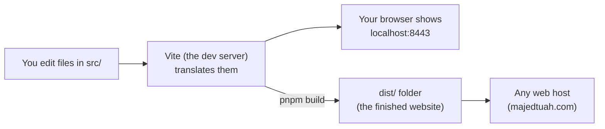

# How majedtuah.com works

This folder explains the whole website from zero. You don't need any front-end experience; each chapter
builds on the one before it.

## Reading order

| # | Chapter | What you'll understand |
|---|---|---|
| 1 | [Web basics](01-web-basics.md) | HTML, CSS, JavaScript, React, TypeScript, Vite, and what "import" means |
| 2 | [Project map](02-project-map.md) | Every file and folder, and which file uses which |
| 3 | [How the page comes together](03-how-the-page-comes-together.md) | From opening the site to seeing the page: components, props, data |
| 4 | [Styling and design](04-styling-and-design.md) | Tailwind classes, `index.css`, colours, fonts, glass |
| 5 | [Animation and motion](05-animation-and-motion.md) | The intro, smooth scroll, reveals, carousels, parallax, the 3D scene |
| 6 | [How to change things](06-how-to-change-things.md) | Recipes: edit text, add a project, change a colour, and so on |
| 7 | [Performance and lessons learned](07-performance-and-lessons.md) | Why some effects were removed, and the bugs we hit |
| 8 | [Glossary](08-glossary.md) | Every jargon word in one place |
| 9 | [AI Lab overview](09-ai-lab-overview.md) | What runs where: the in-browser router and the RAG API |
| 10 | [BrainDump in the browser](10-braindump-in-the-browser.md) | How your trained models were converted, checked and run in the browser |
| — | [Decision log](decisions.md) | *Why* every technical choice was made |
| — | [Changelog](../CHANGELOG.md) | What changed, version by version |

## The one-minute version

- **All the words on the site** (jobs, projects, skills, teaching) live in **one file**: [`src/data.ts`](../src/data.ts).
- **Each section of the page** is its own file in [`src/components/`](../src/components/).
- **All colours, fonts and most visual styles** live in [`src/index.css`](../src/index.css).
- **All the motion helpers** (smooth scroll, text reveals, the clock) live in [`src/motion/`](../src/motion/).

## Everyday commands

Run these in the VS Code terminal, inside the project folder. On your Windows PowerShell, `npx` must be typed
`npx.cmd`. Use `pnpm@11` because that's the version that installed this project's packages.

| Command | What it does |
|---|---|
| `npx.cmd pnpm@11 dev` | Starts the site at http://localhost:8443. It updates live as you save files. |
| `npx.cmd pnpm@11 build` | Makes the final, optimised website in a `dist/` folder |
| `npx.cmd pnpm@11 preview` | Serves that `dist/` folder, so you see the real speed |
| `npx.cmd pnpm@11 test` | Runs the automated tests (the AI Lab's model checks) |
| `npx.cmd pnpm@11 install` | Re-downloads all the packages (only needed if `node_modules` is missing) |
